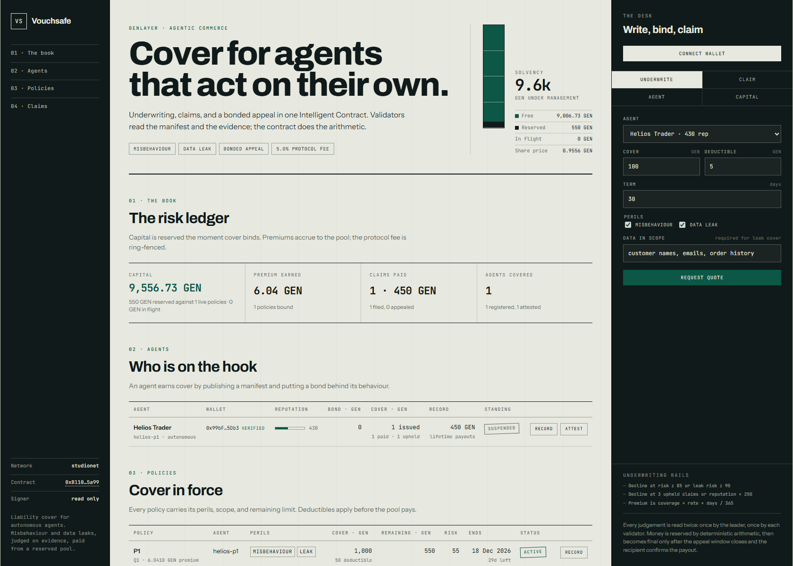
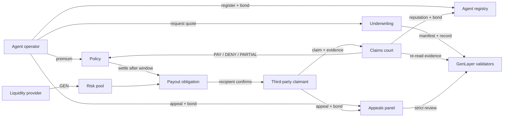

<div align="center">

# Vouchsafe

**Bonded liability for agents that act on their own.**

A complete liability product for agentic commerce: on-chain registry, underwriting, evidence court, bonded appeals and bond-first payouts. The protocol is a GenLayer Intelligent Contract; the product is the live React desk, wallet flow and public record around it.


[](https://github.com/dhozil/vouch-safe)

[Architecture](docs/architecture.md) · [Quick start](#quick-start) · [Vercel](#deploy-to-vercel) · [Contract API](#contract-api) · [Live proof](#live-on-studionet) · [Frontend wiring](#contract--frontend-wiring)

</div>

---

> [!NOTE]
> **Live on Studionet** — contract `0xB110510d859049064ac2c9073f22E1bB55b55a99` · deploy `0x65f530296fb05e2984527405e7680983a4cd0f24e6633eba0c42787e5c7d9890` · gasless, chain id `61999`.

<p align="center">
  
</p>

## Why this exists

Agentic commerce already has payments (x402), identity (ERC-8004), and messaging (A2A). What it does not have is a neutral way to answer the expensive question:

> **When an autonomous agent misbehaves or leaks data, who pays?**

Vouchsafe is an end-to-end liability product for that gap: the contract holds the book, and the React desk gives operators, claimants and LPs a live view plus wallet-signed actions. An agent publishes a manifest and backs it with a bond. A liquidity pool sells cover. A third party files a claim with evidence. GenLayer validators independently re-read the evidence and decide. Money moves only after an appeal window, and only once the recipient confirms delivery.

Every number in the desk is read from the contract; every write is a wallet transaction. There is no app backend and no mock fallback.

| Layer | What it does | Consensus? |
|---|---|---|
| **Agent registry** | Operator ↔ wallet binding, manifest, bond, reputation | Yes — is the manifest genuine? |
| **Underwriting** | Accept/decline, exclusions, conditions, premium | Yes — is the agent insurable? |
| **Claims court** | Pay / partial / deny, covered peril, payout ratio | Yes — what does the evidence prove? |
| **Appeals panel** | Uphold or overturn the first verdict | Yes — strict re-derivation |
| **Pool & settlement** | Shares, reserves, deductibles, caps, deadlines | No — deterministic arithmetic |

## How it works



### Lifecycle

```text
request_quote ──► bind_policy ──► file_claim ──► respond / waive ──► adjudicate
                                                                       │
     ┌─────────────────────────────────────────────────────────────────┤
     │                                                                 │
     ▼                                                                 ▼
  PAY_PENDING                                                      DENY_PENDING
     │ appeal + bond                                                  │ settle
     ▼                                                                ▼
  APPEALED ──resolve──► PAY_FINAL / DENY_FINAL                     DENY_FINAL
     │
     ▼ settle after window
  PAY_SENT ──confirm_payout──► PAID
     │
     └── returned ──► FAILED ──retry_payout──► PAY_SENT
```

Money never moves with a verdict. Settlement creates a **payout obligation**; `confirm_payout` finalises it, and a returned transfer reopens it for retry instead of burning the claim.

## Consensus design

GenLayer is used only where judgement is unavoidable. Everything that can be arithmetic is arithmetic.

| Operation | Model decides | Validators require |
|---|---|---|
| `attest_agent` | document semantics | exact booleans + autonomy enum; wallet/name checks run in code |
| `request_quote` | accept / decline + rationale | same decision; **risk, leak, and flags are derived from storage** |
| `adjudicate_claim` | verdict, peril, ratio, fraud | same verdict/fraud/peril, same 5% ratio band, same usable source hosts |
| `resolve_appeal` | strict re-derivation | same schema, same corroboration rule |

### Why the premium is deterministic

A live quote once went `UNDETERMINED` because two honest validators produced different advisory risk scores. Vouchsafe fixed the root cause: the model only returns `decision`, `confidence`, `exclusions`, `conditions`, and `rationale`. `risk_score`, `data_leak_risk`, and flags are computed in-contract from the attestation and on-chain record. Every node prices the same premium.

### Why the payout is banded

The model returns a **payout ratio**, not an amount. The contract snaps it to a 5% band and computes:

```text
gross    = claimed × payout_ratio / 10,000
gross    = min(gross, policy.remaining)
payout   = max(0, gross − deductible)
payout   = min(payout, pool.assets)
shortfall = approved − payout
```

Validators must agree on the band, so money is identical on every node.

### Why large claims need corroboration

A payout above `max(100 GEN, 10% of coverage)` needs at least **two distinct claimant source hosts** that actually fetched successfully. Defence sources do not count. This is a deterministic post-verdict rule, not a model promise. A single fabricated page cannot set a large loss amount.

### Why the bond is slashed first

At settlement:

```text
slashed = min(payable, agent.bond)
pool.assets += slashed
```

The agent absorbs the first loss; the pool absorbs the remainder. A bond below the minimum suspends the agent until the operator tops it up.

## Contract ↔ frontend wiring

The contract is wired into the frontend through `frontend/.env.local`:

```bash
VITE_NETWORK=studionet
VITE_CONTRACT_ADDRESS=0xB110510d859049064ac2c9073f22E1bB55b55a99
```

`frontend/src/api.ts` exports `CONTRACT` from `VITE_CONTRACT_ADDRESS` and uses it for every `genlayer-js` read and write. The running Vite dev server is on **http://localhost:5173** and reads the live book from this address.

- **Live mode** — reads the contract through `readContract`; writes are signed by an EIP-1193 wallet.
- **Demo mode** — `VITE_DEMO=1` renders a declared sample book so the layout can be reviewed without chain state or a wallet. Writes are disabled.
- **Pinned SDK** — `genlayer-js@1.1.8`. The 2.0 RC changes the calldata envelope and Studionet rejects its `gen_call` reads.
- **Read throttling** — Studio allows roughly 30 `gen_*` calls a minute; the client caps concurrent reads at 3 and retries transient failures.

Every entity has a **Record** action in the UI. It opens a drawer backed by `get_agent`, `get_quote`, `get_policy`, or `get_claim`, and separates **AI consensus** from **contract arithmetic**, with cited sources, full sha256 fingerprints, payout ledger status, and a re-read button.

## Live on Studionet

| | |
|---|---|
| Contract | `0xB110510d859049064ac2c9073f22E1bB55b55a99` |
| Deploy tx | `0x65f530296fb05e2984527405e7680983a4cd0f24e6633eba0c42787e5c7d9890` |
| Quote → bind | `0x2364ec0f…` → `0x03778c91…` |
| Claim → adjudicate | `0xeb742aa9…` → `0x3ad6e884…` — PAY, 10,000 bps, two hosts |
| Settle → confirm | `0xda6c466b…` → `0x2cc5031f…` — PAY_SENT → DELIVERED |
| Evidence | `https://paste.rs/lneLn` + `httpbin.org` corroboration |

Current book:

```text
capital        9,556.73 GEN
reserved         550.00 GEN
in flight          0.00 GEN
premium earned     6.04 GEN
claims paid        1 × 450 GEN
bond slashed       1.00 GEN
agent status       SUSPENDED (bond below minimum)
```

Read it yourself:

```bash
genlayer call 0xB110510d859049064ac2c9073f22E1bB55b55a99 get_pool
genlayer call 0xB110510d859049064ac2c9073f22E1bB55b55a99 get_agent --args helios-p1
genlayer call 0xB110510d859049064ac2c9073f22E1bB55b55a99 get_claim --args C1
```

## Quick start

```bash
git clone https://github.com/dhozil/vouch-safe.git
cd vouch-safe

# 1. Tooling
pip install -r requirements.txt
npm install -g genlayer

# 2. Static checks
genvm-lint check contracts/vouchsafe.py

# 3. Direct-mode tests (mocked web + LLM; no network)
pytest tests -q
# 48 passed

# 4. Deploy (Studionet is gasless)
genlayer network set studionet
genlayer deploy --contract contracts/vouchsafe.py --args 500 500000000000000000

# 5. Frontend
cd frontend
cp .env.example .env.local   # set VITE_CONTRACT_ADDRESS
npm install
npm run dev                  # http://localhost:5173
```

Constructor args are `fee_bps` and `min_bond_atto` in atto (`10^-18 GEN`); the example is a 0.5 GEN minimum bond.

> [!IMPORTANT]
> The `genlayer` CLI always sends `value: 0`. It can drive non-payable writes, but **funding the pool, posting a bond, paying a premium, and posting an appeal bond require a value-capable client** — the frontend wallet or a small `genlayer-js` script.

<details>
<summary><strong>Seed script (genlayer-js)</strong></summary>

```js
// frontend/seed.mjs
import { createClient } from 'genlayer-js'
import { studionet } from 'genlayer-js/chains'
import { privateKeyToAccount } from 'viem/accounts'

const account = privateKeyToAccount(process.env.PRIVATE_KEY)
const client = createClient({ chain: studionet, account })
const address = '0xB110510d859049064ac2c9073f22E1bB55b55a99'
const GEN = 10n ** 18n

await client.writeContract({ address, functionName: 'fund_pool', args: [], value: 100n * GEN })
await client.writeContract({
  address,
  functionName: 'register_agent',
  args: ['helios', 'Helios Trader', '0xYourAgentWallet', 'quote,swap', 'https://your.agent/manifest.json'],
  value: GEN / 2n,
})
```

</details>

## Deploy to Vercel

This repository is Vercel-ready as a **static Vite frontend**. There are no server functions; the browser reads Studionet directly and signs writes with an injected wallet.

**Zero-config from the repository root**

1. Import [`dhozil/vouch-safe`](https://github.com/dhozil/vouch-safe) into Vercel.
2. Leave **Root Directory** empty. The root `vercel.json` runs `npm --prefix frontend ci`, builds `frontend`, and publishes `frontend/dist`.
3. Deploy.

**Or set the project root to `frontend`**

| Setting | Value |
|---|---|
| Root Directory | `frontend` |
| Framework Preset | `Vite` |
| Install Command | `npm ci` |
| Build Command | `npm run build` |
| Output Directory | `dist` |
| Node.js | `22.x` (`.nvmrc` included) |

`frontend/.env.production` already contains the public build-time config, so the first deploy works without dashboard variables:

```bash
VITE_NETWORK=studionet
VITE_CONTRACT_ADDRESS=0xB110510d859049064ac2c9073f22E1bB55b55a99
```

If you add the same keys in **Vercel → Settings → Environment Variables**, they override the file. Vite inlines these values at build time, so redeploy after changing them.

After deployment, reads work without a wallet; funding, bonding, premiums, appeals, and payouts need a browser wallet. Studionet's public RPC throttles reads, and the desk backs off/retries rather than hiding the error.

## Contract API

<details open>
<summary><strong>22 write methods</strong></summary>

| Method | Purpose |
|---|---|
| `fund_pool()` / `withdraw_pool(shares)` | LP deposit and withdrawal; withdrawal creates a payout obligation |
| `register_agent(id, name, wallet, capabilities, manifest_url)` | Register an agent with a bond |
| `add_bond(id)` / `withdraw_bond(id, amount)` | Adjust the bond; `add_bond` is payable and credits the sent value, withdrawal is locked while cover is live |
| `set_agent_status(id, status)` | `ACTIVE` or `RETIRED` |
| `attest_agent(id)` | Verify the manifest and bind the wallet |
| `request_quote(agent_id, coverage, deductible, term_days, perils, data_scope)` | Underwrite and price cover; `term_days` is an integer day count (1-365), not atto |
| `bind_policy(quote_id)` | Pay the premium and reserve coverage |
| `file_claim(policy_id, ref, type, description, claimed, evidence_urls)` | File a claim with at least `min_evidence_urls` (default 2) |
| `respond_to_claim(claim_id, statement, evidence_urls)` / `waive_response(claim_id)` | Insured files a defence or waives the 2-day window |
| `adjudicate_claim(claim_id)` | Read both sides and reach a verdict |
| `appeal_claim(claim_id)` / `resolve_appeal(claim_id)` / `expire_appeal(claim_id)` | Bonded re-adjudication with a 7-day bounded exit |
| `settle_claim(claim_id)` | Permissionless payout obligation after the appeal window |
| `confirm_payout(payout_id)` / `retry_payout(payout_id)` | Recipient confirms delivery; anyone retries a returned transfer |
| `close_policy(policy_id)` | Release coverage after the reporting window |
| `set_terms(...)` / `claim_treasury()` | Operator controls |

</details>

<details>
<summary><strong>15 view methods</strong></summary>

`get_terms`, `get_pool`, `get_shares`, `get_agent`, `get_quote`, `get_policy`, `get_claim`, `get_payout`, `get_pending_payouts`, `get_stats`, and paginated `list_agents`, `list_policies`, `list_claims`, `list_quotes`, `list_payouts`.

</details>

## Protocol invariants

Claim-lifecycle conservation (covered by the direct suite):

```text
premium = coverage × rate × term_days / (10,000 × 365)
rate    = 180 + risk×6 + leak×3 + upheld×60 + unverified(200) + data_leak(120)
rate    = min(rate, 3,500 bps)

assets ≥ reserved
free   = assets − reserved

assets + treasury + pending_payout + confirmed_claim_payouts
  = deposits + premiums + bond_slashed
```

- Coverage is reserved at bind time; LPs can only withdraw `assets − reserved`.
- Payouts are capped by the approved amount, remaining coverage, and pool liquidity; any shortfall is recorded.
- Terms are snapshotted: `fee_bps` on the quote, `fee_atto` + `report_window` on the policy, `appeal_window` on the claim.
- Reputation starts at 500/1000 and moves only on verification transitions and confirmed payouts.

## Repository map

```text
contracts/vouchsafe.py    Intelligent Contract — 37 methods (15 view / 22 write)
tests/test_vouchsafe.py   48 direct-mode tests, including validator disagreement
docs/architecture.md         boundaries, consensus rules, state machine, threat model
docs/vouchsafe.png         live book screenshot
frontend/                    React + Vite desk, record drawer, tx monitor
```

## Security notes & limitations

- Single-asset GEN pool; no reinsurance or formal capital model beyond reserves and the bond-first waterfall.
- Corroboration checks distinct **hosts**, not legal ownership; it raises the cost of a fabricated claim, not eliminates it.
- Evidence stays off-chain; the contract stores fetch status and full sha256 fingerprints, not source text.
- Claim fraud is handled by evidence-weighted judgement, a bond, and reputation — not cryptographic proof.
- Manifest attestation proves what a document says at fetch time, not that the operator controls the wallet.
- `set_terms` is operator-controlled; production should put it behind a timelock or multisig.
- The public explorer is intermittent; the UI copies addresses/hashes and re-reads state from the contract.

## More

- [Architecture and threat model](docs/architecture.md)
- [Frontend source](frontend/)
- [Contract source](contracts/vouchsafe.py)
